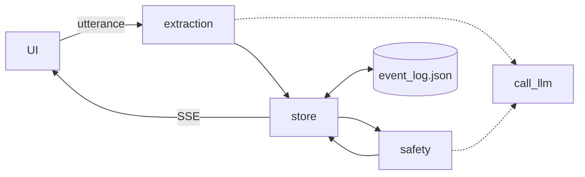

# Design Document: Ambulance Scribe Contract

## Overview
- Contract first: schema, TS types, mocks, `api.md`, stub API, module stubs, steering, README.
- `types.ts` is hand-written to match `schema.py`; `tsc --noEmit` on the mock JSON must pass.
- The event log is the truth; the record is its pure fold, persisted to JSON.
- Facts carry provenance; quotes are utterance substrings.
- Contradictions never overwrite: keep both sources, mark `conflicted`.
- Flags are deterministic, cited rules; the LLM only phrases `say_to_crew`; a human relays it. Footer: "decision support, not clinical advice."
- Unauthenticated, synthetic data; CORS allows only `http://localhost:5173` and `http://127.0.0.1:5173`.

## Architecture



Per utterance: validate, log, extract, `facts_from`, `evaluate`, log new flags, broadcast. Stubs serve an in-memory mock copy. Run `uvicorn backend.main:app --port 8000` from root.

| Folder | Owner |
|---|---|
| `shared/` | Contract |
| `backend/extraction/` | Account A |
| `backend/safety/` | Account B |
| `frontend/` | Account C |
| `backend/store/`, `backend/outputs/`, `scenarios/`, `eval/` | Account D |

Each backend package exposes its signatures in `__init__.py`; `main.py` and `llm.py` stay at backend root; `scenarios/` and `eval/` start with placeholder READMEs.

## Components and Interfaces

```python
def call_llm(prompt: str) -> str: ...  # backend/llm.py; reads LLM_API_KEY per call
# backend/extraction/__init__.py
def process_utterance(utterance: Utterance, record: PatientRecord) -> PatientRecord: ...  # stub: unchanged
# backend/safety/__init__.py
def evaluate(record: PatientRecord) -> list[Flag]: ...  # stub: []; id = f"{type}:{sha1(type + rule_key + sorted evidence)[:12]}"
# backend/outputs/__init__.py
def make_sbar(record: PatientRecord, flags: list[Flag]) -> str: ...  # stub: placeholder
def make_pre_alert(record: PatientRecord, flags: list[Flag]) -> str: ...  # stub: placeholder
def make_checklist(record: PatientRecord) -> list[str]: ...  # stub: ["Prepare bed"]
# backend/store/__init__.py
def append(event: Event) -> Event: ...
def events() -> list[Event]: ...  # oldest first
def derive(events: list[Event]) -> tuple[PatientRecord, list[Flag]]: ...
def facts_from(utt: Utterance, old: PatientRecord, new: PatientRecord) -> list[Event]: ...
async def subscribe() -> AsyncIterator[tuple[str, dict]]: ...
```

Stable flag ids preserve status; safety lookups read through committed `backend/safety/cache/`. Store rules, all inside `derive`:
- `fact`: empty field → value, `unverified`; same value → add source (dedupe `utterance_id`+`quote`); different → keep old, add source, `conflicted`.
- List fields append (duplicates are safety's job); status events set status.
- Each append persists gitignored `backend/store/event_log.json`, replayed on startup.

| Endpoint | 200; errors |
|---|---|
| POST `/api/utterance` `{text, ts}` | `PatientRecord`; 422, 500 |
| GET `/api/stream` | SSE `record`·`flags`·`clocks` (`Clocks`) |
| GET `/api/record`·`flags`·`events` | `PatientRecord`·`Flag[]`·`Event[]` |
| GET `/api/sbar`·`preAlert`·`checklist` | `string`·`string`·`string[]`, empty if none |
| POST `/api/flags/{id}/relay`·`ack` | `Flag`; 404, 409 |
| POST `/api/fields/{path}/confirm` | `Sourced`; 404 |
| GET `/api/scenarios` | `string[]` scenario ids |
| POST `/api/scenario/{id}/play` | `PatientRecord` from `scenarios/{id}.json`; 404 |

- Stub mode: both scenario endpoints return 200 with no side effects (unknown id still 404).
- Repeats: 200, no event. `{path}`: `.`-joined names/indexes (`age`, `meds_given.0`). Responses schema-validated, else 500.
- SSE: all three on connect, `clocks` every 1 s, changes within 1 s. Nothing reaches crew devices.

## Data Models

Pydantic v2 mirrored in TS; enums `str, Enum`/literal unions; offset-aware timestamps; `extra="forbid"`. Event kinds: `utterance {utterance}`, `fact {path, value, source, confidence}`, `flag_raised {flag}`, `flag_relayed {flag_id}`, `flag_acked {flag_id}`, `field_confirmed {path}`.

| Model | Fields |
|---|---|
| Enums | `FieldStatus` `confirmed·unverified·conflicted·unknown`; `FlagType` `duplicate_dose·allergy_conflict·interaction·contradiction·missing_info`; `FlagSeverity` `critical·warn·info`; `FlagStatus` `open·relayed·acknowledged` |
| `SourceRef`, `Citation` | `utterance_id` 1–128, `quote` 1–1000, `ts`; `name` 1–200, `url` http(s) ≤2048 |
| `Sourced[T]` | `value` T\|None, `status=unknown`, `confidence` finite 0–1 `=0`, `sources` ≤20 |
| `Medication`, `VitalsEntry` | `drug`/`dose`/`route`/`time`/`given_by` ≤200\|None; `ts`, nullable `hr` 0–300, `bp` `^\d{2,3}/\d{2,3}$`, `spo2`/`rr` 0–100, `source` ≤200 |
| `PatientRecord` | Sourced `age`/`sex`/`chief_complaint`/`suspected_condition`/`eta`/`acuity_esi` (1–5)/`allergies` (str[]); `meds_given` Sourced[Medication][]; `vitals_timeline`; lists ≤100; `notes` ≤5000 |
| `Flag`, `ErrorBody` | `id` 1–64, `type`, `severity`, `message` 1–500, `say_to_crew` 1–280 non-blank, `evidence` 0–10 × 1–500, `source_ref: Citation`, `status=open`; `category`, `field?`, `detail` |
| `Utterance`, `UtteranceRequest` | `id` 1–128 (Utterance only), `text` 1–2000, `ts` |
| `Event`, `ClockEntry` | `id` 1–128, `ts` UTC ms, `kind` 1–64, `payload` ≤64 KB; `med_id` field path (e.g. `meds_given.0`), `last_dose_ts`, `elapsed_s` ≥0 |
| `Clocks` | `contact_ts`, `eta`, `door_to_ecg_target_ts`, `meds: ClockEntry[]` |

## Correctness Properties

*A property is a characteristic or behavior that should hold true across all valid executions of a system-essentially, a formal statement about what the system should do. Properties serve as the bridge between human-readable specifications and machine-verifiable correctness guarantees.*

### Property 1: Schema round trip
For any valid `Sourced`, `PatientRecord`, `Flag`, or `Event`, JSON round-trips to an equal object and identical JSON.
**Validates: Requirements 3.1, 3.2, 3.3, 4.1, 4.2, 4.3, 4.4, 4.5, 4.6, 4.9, 5.1, 5.2, 5.7, 6.1, 6.6**
### Property 2: Invalid input rejected whole
For any valid instance with one invalidating mutation, validation raises naming the mutated field.
**Validates: Requirements 3.4, 3.5, 3.7, 4.10, 4.11, 4.12, 5.4, 5.5, 11.1, 11.2**
### Property 3: Append is all-or-nothing
For any log and event, `append` yields `log + [event]` or raises with the log unchanged.
**Validates: Requirements 6.7, 6.8, 6.9**
### Property 4: Replay equals live
For any event sequence, incremental derivation equals `derive(all_events)`, including after reload.
**Validates: Requirements 6.4, 6.5**
### Property 5: Quotes are substrings
For any utterance and proposal, every emitted quote is an utterance substring; others yield no `fact`.
**Validates: Requirements 6.4** (plus quote rule)
### Property 6: Contradiction never overwrites
For any field holding `v` and a `fact` with `w ≠ v`, `v` stays, both sources remain, status becomes `conflicted`.
**Validates: Requirements 6.4** (plus conflict rule)
### Property 7: Flag state machine
For any relay/ack sequence, flags go open → relayed → acknowledged; repeats 200, skips/reversals 409, unknown 404; failures inert.
**Validates: Requirements 7.12, 9.6, 9.7, 9.8, 9.15, 11.3, 11.7**
### Property 8: Endpoint input validation
For any confirm path or utterance body, valid input succeeds (field `confirmed`), else 404/422 naming the problem.
**Validates: Requirements 7.9, 9.5, 9.9, 9.10**

## Error Handling
- 422 `validation`, 404 `not_found`, 409 `conflict`, 500 `processing`/`response_validation`; append runs last, so failures change nothing.
- `call_llm` raises `RuntimeError("LLM_API_KEY not set")` pre-network; safety falls back to template `say_to_crew`.
- Corrupt `event_log.json` blocks startup.

## Testing Strategy
- `pytest`+`hypothesis`, `vitest`, `tsc --noEmit` on mock JSON typed `PatientRecord`/`Flag[]`.
- One Hypothesis test per property, ≥100 examples, tagged `# Feature: ambulance-scribe-contract, Property N: <title>`.
- Examples: defaults, endpoints, SSE cadence, CORS, forced 500, unset key, stubs, footer. Smoke: `eval/check_contract.py`. Pass: `tsc --noEmit` on mock JSON exits 0; `eval/validate_mock.py` prints `OK`.
