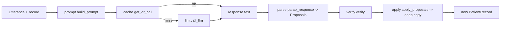

# Design Document

## Overview

The Extraction package turns one paramedic `Utterance` into structured
`PatientRecord` facts with provenance. Its single public function
`process_utterance(utterance, record) -> PatientRecord` keeps the Phase 1
signature and orchestrates a pure pipeline: build a prompt, get an LLM response
(cache-first), parse strict-JSON proposals, verify every quote against the
utterance text, and apply surviving proposals to a deep copy of the record.
Extraction only appends facts and sources; it never resolves conflicts and
never mutates the input (Req 1, 2, 3). Models are imported read-only from
`shared.schema`; `call_llm` is reached via `from backend import llm` so tests
can monkeypatch `backend.extraction.llm` or `backend.llm` (Req 1.1). Edits are
confined to `backend/extraction/`.

## Architecture

Data flows one way. The input record is read-only input to `build_prompt` and
`apply_proposals`; the only record returned is the fresh deep copy (Req 3.1).

## Components and Interfaces

### `__init__.py` — orchestration (public)
`process_utterance(utterance: Utterance, record: PatientRecord) -> PatientRecord`.
Sequence: `prompt = build_prompt(utterance, record)`; `text =
get_or_call(utterance, prompt)`; `proposals = parse_response(text)`; `proposals
= verify(proposals, utterance)`; `return apply_proposals(record, proposals,
utterance)`. Imports `from backend import llm`; `cache` calls
`llm.call_llm(...)` (Req 1.1, 6.2 — no try/except around the call).

### `prompt.py`
`build_prompt(utterance, record) -> str`. Instructs the LLM to return a single
strict-JSON object `{"facts": [{path, value, quote, confidence, hedged}]}`;
`quote` must be copied verbatim from the utterance; relative times must be
resolved against `utterance.ts` as offset-aware ISO 8601; lists the extractable
paths (Req 1.1, 1.2, 4.3).

### `cache.py`
`get_or_call(utterance, prompt) -> str`. `key = sha256(utterance.text).hexdigest()`;
file `backend/extraction/cache/{key}.json` holding `{"text", "response"}`. Hit →
return cached `response` without calling the LLM (Req 5.2). Miss or unreadable/
corrupt file → `llm.call_llm(prompt)`, write cache, return (Req 5.1, 5.3, 5.4).
A missing key on a miss lets `call_llm`'s `RuntimeError` propagate unchanged
(Req 6.1, 6.2). Cache files are tracked in VCS (Req 5.5).

### `parse.py`
`parse_response(text) -> list[Proposal]`. Tolerant parse: strip code fences,
locate the JSON object, read `facts`. Malformed JSON → `[]` (Req 1.8). Drop
entries missing a required key or whose `confidence` is outside 0..1.

### `verify.py`
`verify(proposals, utterance) -> list[Proposal]`. Keep a proposal only if its
`quote` is a case-sensitive substring of `utterance.text` **and** its `path` is
a known `PatientRecord` path; drop the rest (Req 2.2, 2.3, 2.4).

### `apply.py`
`apply_proposals(record, proposals, utterance) -> PatientRecord`. Deep-copy via
`record.model_copy(deep=True)` so input is never mutated (Req 3.1). For each
proposal build `SourceRef(utterance_id=utterance.id, quote=proposal.quote,
ts=utterance.ts)` (Req 2.1, 2.5). Scalars (`age`, `sex`, `chief_complaint`,
`suspected_condition`, `eta`, `acuity_esi`): assign `value`, append the source,
set `confidence`, set `status = unverified` if `hedged` else `confirmed` (Req
1.3, 4.1, 4.2); `acuity_esi` outside 1..5 is skipped (Req 1.5, 1.6). `allergies`:
append each value's source on the `Sourced[list[str]]` (Req 7.2). `meds_given`:
append a new `Sourced[Medication]` (Req 1.7, 7.3). `vitals_timeline`: append a
`VitalsEntry`. Appending a differing value assigns the new value but leaves
prior sources in place so the store can detect the conflict; status is never
`conflicted` (Req 3.2, 3.3); sources are capped at 20.

## Data Models

`Proposal` is a small dataclass (internal to the package):

| field | type | maps to |
|---|---|---|
| `path` | `str` | target `PatientRecord` path (`age`, `acuity_esi`, `allergies`, `meds_given`, `vitals_timeline`, ...) |
| `value` | `Any` | `Sourced.value`, an `allergies` list item, `Medication`, or `VitalsEntry` |
| `quote` | `str` | `SourceRef.quote` (verbatim) |
| `confidence` | `float` | `Sourced.confidence` (0..1) |
| `hedged` | `bool` | drives `Sourced.status`: `unverified` when true, else `confirmed` |

Every applied fact yields a `SourceRef(utterance_id, quote, ts)` from the
utterance. `meds_given` maps a proposal to `Medication(drug, dose, route, time,
given_by)` wrapped in `Sourced[Medication]`; `vitals_timeline` maps to a
`VitalsEntry`; `allergies` appends string values to `Sourced[list[str]]`.

## Correctness Properties

*A property is a characteristic or behavior that should hold true across all valid executions of a system — a formal statement about what the system should do, bridging human-readable specs and machine-verifiable guarantees.*

### Property 1: Provenance on every applied field
*For any* record, utterance, and verified proposals, every field set by `apply_proposals` carries at least one `SourceRef` whose `quote` is a substring of `utterance.text`, whose `utterance_id == utterance.id`, and whose `ts == utterance.ts`.
**Validates: Requirements 1.3, 2.1, 2.5**

### Property 2: Untouched fields are preserved
*For any* record and proposal set, every field with no proposal is identical in the returned record to the input record.
**Validates: Requirements 1.4**

### Property 3: acuity_esi stays within 1..5
*For any* proposal set, `acuity_esi` is set only when its value is an integer in 1..5; an out-of-range value is skipped and all other valid facts are still applied.
**Validates: Requirements 1.5, 1.6**

### Property 4: Non-conforming output yields no facts
*For any* text that is not a single conforming JSON object, `parse_response` returns `[]` and `process_utterance` returns a record equivalent to the input.
**Validates: Requirements 1.8**

### Property 5: Only verified substring quotes survive
*For any* proposals and utterance, a proposal survives `verify` exactly when its `quote` is a case-sensitive substring of `utterance.text` and its `path` is a known record path; all others are dropped.
**Validates: Requirements 2.2, 2.3, 2.4**

### Property 6: Input record is never mutated
*For any* record and proposals, the input record's JSON serialization is identical before and after `apply_proposals`, and the returned record is a distinct object.
**Validates: Requirements 3.1**

### Property 7: Differing values append, prior sources remain
*For any* field holding an existing value, applying a differing proposal leaves the prior `SourceRef` present in the result so the store can detect the conflict.
**Validates: Requirements 3.2**

### Property 8: Status is never conflicted
*For any* proposals, no field set by `apply_proposals` ends with status `conflicted`.
**Validates: Requirements 3.3**

### Property 9: Hedged facts are unverified and no more confident
*For any* fact, applying it hedged yields status `unverified` and a confidence no greater than applying the same fact unhedged.
**Validates: Requirements 4.1, 4.2**

### Property 10: Cache round-trip and reuse
*For any* utterance text, a miss calls the LLM once and writes `{text, response}`; an identical later call returns the cached response with no further LLM call; a corrupt cache file is treated as a miss.
**Validates: Requirements 5.1, 5.2, 5.3, 5.4**

## Error Handling

- **No key, no cache:** `cache.get_or_call` calls `llm.call_llm`, which raises `RuntimeError("LLM_API_KEY not set")`. Nothing in the pipeline catches it; it propagates to the caller unchanged (Req 6.1, 6.2).
- **No key, cache hit:** the cached response is returned and no key is read, so no error is raised (Req 6.3).
- **Malformed LLM output:** `parse_response` returns `[]`; the record comes back with no new facts (Req 1.8).
- **Non-substring or unknown-path quote:** `verify` drops the proposal; a fact with no surviving source is dropped (Req 2.3, 2.4).
- **Corrupt/unreadable cache file:** treated as a miss; the LLM is called and the file is rewritten (Req 5.4).
- **Out-of-range `acuity_esi`:** skipped; other facts still apply (Req 1.6).

## Testing Strategy

**Dual approach.** Property-based tests (Hypothesis, per the project stack, min 100 iterations each) cover Properties 1–10 for the pure parse/verify/apply logic; example-based pytest tests cover the prescribed scenarios and the error condition. `call_llm` is patched so no test makes a network call (Req 7.1). Property tests use mocks/temp dirs for the cache so iterations stay cheap. Each property test is tagged **Feature: extraction, Property {n}: {property text}** and references its design property.

Five required pytest tests under `backend/extraction/tests/` (Req 7.1–7.4):

1. **no-allergies-then-penicillin** — patched `call_llm`; two utterances produce two `allergies` values, each with its `SourceRef`, so the store can later mark `allergies` conflicted (Req 7.2, 3.2).
2. **aspirin-twice** — patched `call_llm`; asserts two `meds_given` entries result, each with its own `SourceRef` (Req 7.3).
3. **no-key-no-cache raises** — `LLM_API_KEY` unset, empty temp cache dir; asserts `process_utterance` raises a `RuntimeError` naming `LLM_API_KEY` (Req 6.1, 6.2).
4. **quote-not-substring dropped** — a proposal whose quote is not in `utterance.text` is dropped and does not appear in the result (Req 2.3, 2.4).
5. **input-not-mutated** — snapshots the input record's JSON before and after and asserts equality (Req 3.1).

All tests pass under pytest from the repo root (Req 7.4).
