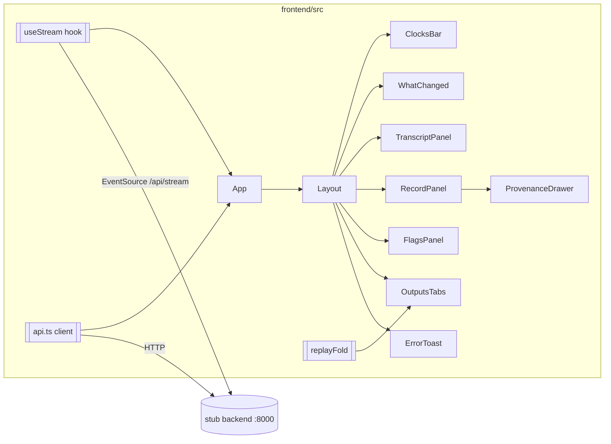

# Design Document

## Overview

The Frontend is a single-screen React + Vite + TypeScript + Tailwind SPA that a human
operator uses during an ambulance run. It consumes the existing stub backend over the
shared HTTP + SSE contract ([`shared/api.md`](../../../shared/api.md)), importing every
data type from [`shared/types.ts`](../../../shared/types.ts). All work stays inside
`frontend/`; `shared/` and `backend/` are read-only. The screen shows a live transcript,
a provenance-carrying patient record, safety flags with a human-in-the-loop relay, live
clocks, generated outputs, and a replay scrubber. The machine never speaks to the crew:
the operator relays every `say_to_crew` line.

## Architecture

- **Data flow:** `useStream` holds the latest `record`, `flags`, `clocks` from SSE named
  events and reconnects on drop. Imperative actions (post utterance, confirm, relay/ack,
  play scenario, load outputs/events) go through `api.ts`.
- **Shared-type access:** add a `@shared` path alias in `vite.config.ts` (via
  `resolve.alias`) and in `tsconfig.json` (`paths` + widen `include` to `["src", "../shared"]`).
  Types are imported with `import type { ... } from "@shared/types"`. This keeps all edits
  inside `frontend/`.
- **Config:** API base from `import.meta.env.VITE_API_BASE`, default `http://localhost:8000`.

## Components and Interfaces

- **`api.ts`** — one typed function per endpoint: `postUtterance`, `getRecord`, `getFlags`,
  `getEvents`, `getSbar`, `getPreAlert`, `getChecklist`, `relayFlag`, `ackFlag`,
  `confirmField`, `getScenarios`, `playScenario`, and `openStream` (returns an
  `EventSource`). On a non-2xx response it parses the body as `ErrorBody` and throws
  `ApiError { status: number; body: ErrorBody | null }` (`body` null when unparseable).
- **`useStream()`** — wraps `openStream`, registers listeners for `record`, `flags`,
  `clocks`, keeps each latest payload in state, and reconnects without operator action.
- **Layout** — CSS-grid shell: fixed top bar (ClocksBar + WhatChanged), a 3-column main
  (left transcript+input, center record, right flags), fixed footer. Dark theme
  (`bg-slate-950`, high-contrast text ≥ 7:1), sized to fit 1280×720 with no scroll. Footer
  shows the exact text `decision support, not clinical advice. Synthetic data only.`
- **ClocksBar** — renders `Clocks`; ticks client-side via `setInterval(1s)` between SSE
  `clocks` events; shows placeholders for null `contact_ts`/`eta`/`door_to_ecg_target_ts`;
  renders an overdue state when the door-to-ECG target is in the past; lists per-med
  elapsed from `meds[].elapsed_s`.
- **WhatChanged** — compares previous vs next `record`/`flags` snapshots and renders one
  ≤140-char summary beneath the top bar, replaced on each change.
- **TranscriptPanel** — utterances derived from `GET /api/events` entries of kind
  `utterance`, ascending by `ts`; feature-detected mic button (continuous Web Speech API
  via `window.SpeechRecognition || window.webkitSpeechRecognition`) that posts each
  recognized result; an always-present typed `<textarea>` fallback with 1–2000 char
  validation and retry on failure; a play-scenario control; highlights the active source
  utterance while a drawer is open.
- **RecordPanel + SourcedField** — each `PatientRecord` field with a status badge
  (`confirmed`/`unverified`/`conflicted`/`unknown`), never a value without its badge;
  click opens the ProvenanceDrawer; a Confirm control on `unverified` fields calls
  `confirmField(path)`. Medications use path `meds_given.N` (zero-based).
- **ProvenanceDrawer** — lists every source (quote + ISO-8601 ts) for the selected field
  and exposes the active `utterance_id` so TranscriptPanel can highlight it.
- **FlagsPanel + FlagCard** — flags sorted `critical` > `warn` > `info`, ties oldest-first;
  shows `message`, `evidence`, a `source_ref` link, and a SayToCrewBox with the verbatim
  `say_to_crew` line. Relayed enabled only when `open`; Acknowledged enabled only when
  `relayed`; both disabled when `acknowledged`. Shows returned status + transition on
  success; leaves state unchanged on 409. A newly displayed `critical` flag animates in and
  plays an audible alert exactly once per flag `id`.
- **OutputsTabs** — tabs SBAR / pre-alert / checklist from `getSbar`/`getPreAlert`/
  `getChecklist`, with empty-state and per-tab error placeholders; a replay scrubber over
  `GET /api/events` that reconstructs `{record, flags}` up to the selected event.
- **ErrorToast** — maps `ApiError.status` (422/404/409/500) to messages per Requirement 8,
  with a generic fallback when the body is not a valid `ErrorBody`.

## Data Models

The Frontend introduces no new wire models; it reuses the shared contract types
(`PatientRecord`, `Sourced<T>`, `Flag`, `Clocks`, `ClockEntry`, `Event`, `ErrorBody`,
`UtteranceRequest`, etc.) imported from `@shared/types`. Internal view state:

- `StreamState { record: PatientRecord | null; flags: Flag[]; clocks: Clocks | null }`
- `ApiError { status: number; body: ErrorBody | null }`
- `DrawerState { path: string; sources: SourceRef[] } | null`
- `ReplaySnapshot { record: PatientRecord; flags: Flag[] }` — output of `replayFold`.

`replayFold(events: Event[], upToIndex: number): ReplaySnapshot` is a pure client-side fold
over `events` (oldest→newest) that mirrors the event kinds in `shared/api.md`: `utterance`,
`fact` (sets a `Sourced` field at `path`), `flag_raised`, `flag_relayed`, `flag_acked`,
`field_confirmed`. It starts from an empty record and applies each event in order.

## Correctness Properties

*A property is a characteristic or behavior that should hold true across all valid
executions of a system — a formal statement about what the system should do. Properties
bridge human-readable specifications and machine-verifiable correctness guarantees.*

### Property 1: Disclaimer footer invariant

*For any* stream state, error state, replay position, or open tab, the rendered Layout
SHALL contain the exact footer text `decision support, not clinical advice. Synthetic data only.`

**Validates: Requirements 1.4, 1.5**

### Property 2: Flag-control enablement matches status

*For any* flag, the Relayed control is enabled iff the flag status is `open`, and the
Acknowledged control is enabled iff the flag status is `relayed`; both are disabled when
the status is `acknowledged`.

**Validates: Requirements 4.3, 4.4, 4.5**

### Property 3: Severity sort order

*For any* list of flags, the displayed order is non-increasing by severity rank
(`critical` > `warn` > `info`) and, within equal severity, ascending by first-appearance
time (oldest first).

**Validates: Requirements 4.1**

### Property 4: Replay fold determinism and correctness

*For any* event list and selected index, `replayFold` is deterministic (folding the same
events to the same index yields an identical snapshot), and folding up to the last index
yields the same snapshot as applying every event in order.

**Validates: Requirements 7.6, 7.7**

### Property 5: Critical alert fires once per flag id

*For any* sequence of `flags` payloads, the entrance animation and audible alert for a
given `critical` flag `id` fire exactly once, even if that `id` reappears in later payloads.

**Validates: Requirements 4.10**

## Error Handling

- **Non-2xx responses:** `api.ts` throws `ApiError { status, body }`. `ErrorToast` maps
  422 → validation message (includes `detail`, and `field` when non-null), 404 → not-found
  message with `detail`, 409 → conflict message with `detail` leaving the control unchanged,
  500 (`processing` and `response_validation`) → error message with `detail` leaving record
  state unchanged. An unparseable body (`body === null`) yields a generic failure message.
- **Utterance/scenario POST failures:** retain entered text, show a non-recorded indication,
  and allow retry; scenario failures show a did-not-start indication.
- **Outputs:** per-tab error placeholders leave other tabs unaffected; empty content shows a
  no-content placeholder rather than a blank area.
- **SSE drop:** `useStream` reconnects automatically and resumes all three event handlers.

## Testing Strategy

Tooling: **Vitest** + **@testing-library/react** + **jsdom**. Property tests use
**fast-check** (do not hand-roll property testing). Each property test runs a minimum of
100 iterations and is tagged `Feature: frontend, Property {n}: {property text}`.

- **Property-based (fast-check, ≥100 iterations):**
  - Property 1 — render Layout across generated stream/error/replay states; assert exact footer text.
  - Property 2 — for any flag status, assert control-enablement table.
  - Property 3 — for generated flag lists, assert sort invariant.
  - Property 4 — for generated event lists/indices, assert `replayFold` determinism and full-fold equivalence.
  - Property 5 — feed repeated payloads with a shared critical id; assert alert trigger count is 1 per id (mock audio).
- **Example / unit tests:** typed textarea renders when `SpeechRecognition` is undefined;
  1–2000 char validation; Confirm flow updates badge to `confirmed`; `ErrorToast` mapping
  for 422/404/409/500 and the generic fallback; ClocksBar null placeholders and overdue
  countdown with fake timers; `useStream` reconnect with a mock `EventSource`.
- **Layout checks (example render):** assert the three columns and footer exist; full
  contrast and 1280×720 no-scroll verification is a manual/visual check, not a unit test.
